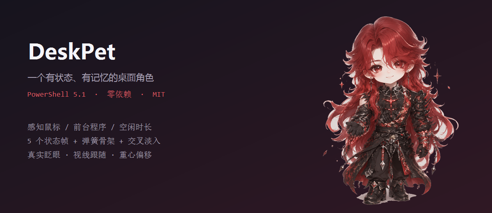

# DeskPet · 一个有状态、有记忆的桌面角色



> **English**: A stateful desktop companion for Windows. It watches your cursor, the foreground app and your idle time, then decides what to do and what to say — no looped GIF. Pure PowerShell 5.1, zero dependencies.

一个会「看你在干什么、记得你、按情境说话」的桌面宠物。它由一组真实动作帧 + 弹簧骨架驱动，而不是循环播放一张动图。

---

## ✨ 特点

**不是动图，是角色**

- 5 个状态帧（站立 / 迈步 / 闭眼笑 / 睡着 / 抬手指），之间做**交叉淡入**，切换不突兀
- 所有运动参数走**弹簧插值**，没有一帧是突变的
- 眼睛最快、头中等、身体最慢 —— 三者相位错开，才像活物

**会感知**

| 信号 | 来源 |
| --- | --- |
| 输入空闲时长 | `GetLastInputInfo`（系统级） |
| 前台程序 | 进程名 → 窗口类名 → 标题关键词 |
| 鼠标位置 | `GetCursorPos` |
| 时间 | 系统时钟 |

**有状态机**

```
interacting  被拖动 / 按住
happy        刚被戳、刚放下
alert        离开很久后回来
speaking     正在说话
sleeping     空闲 > 300 秒
tired        空闲 > 90 秒 / 精力 < 25% / 凌晨
focused      前台是工作程序
happy        前台是娱乐程序
observe      鼠标靠近 260px 内
idle         其余
```

**有记忆**

`pet.memory.json` 记录启动次数、被戳/拖/摸次数、离开又回来次数、亲密度、最近说过的话（用于去重）、连续使用天数、累计工作/摸鱼时长。每 60 秒自动保存。

**会说话**

人格和台词写在 `pet.persona.json`，按「状态 → 情绪 → 时间」挑句子，最近 14 句不重复，专注时 210 秒才说一次。

---

## 🚀 快速开始

### 环境要求

- Windows 10 / 11
- **不需要安装任何东西** —— 用系统自带的 Windows PowerShell 5.1

### 运行

```powershell
git clone <this-repo>
cd DeskPet
```

然后**双击 `start.vbs`**（静默启动，没有黑框）。

或者用命令行：

```powershell
powershell -NoProfile -STA -ExecutionPolicy Bypass -File .\DeskPet.ps1
```

> **看不到宠物？** 双击 `reset.vbs` —— 它会重新启动并直接出现在鼠标旁边。

---

## 🖱 互动

| 操作 | 反应 |
| --- | --- |
| 左键单击 | 跳一下 + 按「被戳」台词回应 |
| 双击 | 当作摸头，亲密度上升 |
| 按住拖动 | 进入 `interacting`，会抗议 |
| 松手 | 带惯性掉落、落地压扁 |
| 鼠标凑近 | 转头看你（换 `look` 帧） |
| 离开很久回来 | 第一句话是「你终于回来了」 |
| 右键 | 说话 / 开心 / 大小 / 置顶 / 锁定 / 换形象 / 显示在哪块屏 / 退出 |
| 拖图片到身上 | 直接换形象 |

---

## ⚙️ 配置

`pet.config.json`：

| 字段 | 说明 |
| --- | --- |
| `size` | 显示大小倍率（1.0 ≈ 132px 高） |
| `weight` | 0.35~0.85，越大越好动 |
| `alwaysTop` | 是否总在最前 |
| `speech` | 是否说话 |
| `blinkEvery` | 平均几秒眨一次眼 |
| `idleChatter` | 平均几秒自言自语，0 = 关闭 |
| `bubbleMs` | 气泡停留毫秒 |
| `reduceMotion` | `true` = 完全不晃不走 |
| `screen` | `auto` 跟着鼠标 / `small` 小屏 / `large` 大屏 / `primary` 主屏 / 设备名 |
| `locked` | 锁定位置 |

`pet.persona.json` 里可以改角色名、自称、性格和全部台词。

---

## 🧩 项目结构

```
DeskPet.ps1        主程序：窗口、主循环、交互、布局
PetRig.cs          渲染器：多帧交叉淡入 + 弹簧骨架
FramePrep.cs       素材处理：去背景、边缘反混合、对齐、缩放
pet.brain.ps1      大脑：感知、状态机、说话、记忆
pet.persona.json   人格与台词库
pet.config.json    行为配置
assets/frames/     5 个动作帧
tools/             辅助脚本
docs/              截图
start.vbs          静默启动
reset.vbs          复位到鼠标旁边
```

### 渲染是怎么做的

```
感知 → 状态机 → 选择帧 + 姿态参数 → 弹簧平滑 → 变换绘制
```

身体绕**脚底**旋转（不是绕中心），幅度只有 1~2 度，所以有站立感而不是漂浮。
变换顺序是 `归零 → 缩放 → 旋转 → 归位`，这样水平翻转（转身）才不会把角色翻到画布外。

### 抠图是怎么做的

1. **颜色模型泛洪**：只接受「够亮 + 够灰」的像素，避免顺着渐变渗进角色
2. **局部背景色比对**：背景是竖向渐变，用局部色判断才不会误删皮肤
3. **边缘反混合**：`F = (C - (1-a)·B) / a`，真正去掉白边/灰边

---

## 🎨 换成你自己的角色

1. 准备几张**同构图**的立绘（推荐 1145×1374，浅灰背景），命名：
   - `assets/chibi_source.png` → `open`
   - `assets/frame_walk.png` → `walk`
   - `assets/frame_smile.png` → `smile`
   - `assets/frame_sleep.png` → `sleep`
   - `assets/frame_look.png` → `look`
2. 运行对齐工具：

```powershell
powershell -NoProfile -STA -ExecutionPolicy Bypass -File .\tools\repack-frames.ps1
```

它会自动去背景、统一包围盒、缩放到 `assets/frames/`，帧之间切换不会跳位。

> 只有一张图也能用：直接拖到宠物身上，或用 `tools/make-pet.ps1` 处理。

---

## 🛠 辅助脚本

| 脚本 | 用途 |
| --- | --- |
| `tools/repack-frames.ps1` | 重新处理动作帧 |
| `tools/make-pet.ps1` | 把单张图片做成形象 |
| `tools/test-brain.ps1` | 状态机单元测试（22 项） |
| `tools/demo-states.ps1` | 打印各场景的决策 JSON |
| `tools/probe-foreground.ps1` | 查看前台窗口识别结果 |

### 调试

```powershell
$env:DESKPET_PROBE = '1'
powershell -NoProfile -STA -ExecutionPolicy Bypass -File .\DeskPet.ps1
```

会往 `render_probe.log` 写每 30 帧的渲染哈希，用来确认画面真的在变。

---

## ❓ 常见问题

**双击没反应？**
执行策略可能拦了。用命令行跑一次：

```powershell
powershell -NoProfile -STA -ExecutionPolicy Bypass -File .\DeskPet.ps1
```

**宠物不见了？**
双击 `reset.vbs`。多显示器时，`pet.config.json` 的 `screen` 可以固定到某块屏。

**画面不动？**
设 `DESKPET_PROBE=1` 启动，看 `render_probe.log` 里的 hash 是否在变。

**觉得晃太多？**
右键「话少一点」，或配置里 `reduceMotion: true`。

---

## 📄 License

[MIT](LICENSE)

> 示例角色为演示用素材，可自行替换为你的角色。
